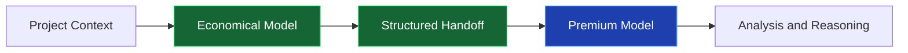

<div align="center">

  

  <h1>Cold Start Brief</h1>

  <h3>Better Handoffs. Lower Costs. Smarter Model Orchestration.</h3>

  <p>
    A Claude Code plugin that writes copy-paste kickoff and handoff prompts for a specific model,
    with the current prompting guide checked and the project scouting already done.
  </p>

<p>
  
  
  
  <a href="LICENSE"></a>
</p>

<h4>
  <a href="#installation">Install</a>
  <span> · </span>
  <a href="https://github.com/ColdBore-RD/cold-start-brief/issues">Report Bug</a>
  <span> · </span>
  <a href="https://github.com/ColdBore-RD/cold-start-brief/issues">Request Feature</a>
</h4>
</div>

<br />

<!-- Table of Contents -->
<details>
<summary><strong>Table of Contents</strong></summary>

- [About the Project](#about-the-project)
- [How it works](#how-it-works)
- [Features](#features)
- [Getting Started](#getting-started)
- [Usage](#usage)
  - [How to use](#how-to-use)
- [Cost and Orchestration](#cost-and-orchestration)
  - [Methodology and Limitations](#methodology-and-limitations)
- [The profile file](#the-profile-file)
- [Secrets](#secrets)
- [Tech Stack](#tech-stack)
- [Roadmap](#roadmap)
- [Contributing](#contributing)
- [FAQ](#faq)
- [Troubleshooting](#troubleshooting)
- [License](#license)
- [Contact](#contact)
- [Acknowledgements](#acknowledgements)

</details>

<!-- About the Project -->
## About the Project

Effective handoffs are a cost optimization strategy, not just a convenience. In two real-world projects, with over 4.1 million preparation tokens, preparing the handoff on Sonnet 5.5 rather than Fable 5.2 cut the estimated combined cost of preparation and the first receiving turn by **10–17%**.

Both handoffs cost less than $1 each to prepare and gave a higher-capability model a structured, context-rich starting point. These findings support the economic rationale behind this skill: assign context preparation to a more economical model, and reserve premium model spending for the reasoning, analysis and decisions where it delivers the most value.

The result is a more deliberate, cost-efficient approach to multi-model AI workflows.

### Performance at a Glance

| Preparation Tokens Analyzed | Preparation Cost Reduction | Combined Estimated Savings | Average Handoff Preparation Cost |
| :---: | :---: | :---: | :---: |
| **4.11M** | **71–73%** | **12.1%** | **$0.83** |

<sub>Estimates from two handoffs that predate this plugin, with no control run. See <a href="#methodology-and-limitations">Methodology and Limitations</a>.</sub>

### What you get

**Cold Start Brief gives you one Markdown file that a fresh session can run without seeing your conversation.** The file holds the facts, the approvals and a definition of done, shaped for the model that will read it.

- **Current guidance:** it reads the target model's official prompting page each time, so it doesn't rely on remembered advice.
- **Scouting done first:** it reads the project read-only and reports dates, conflicts between sources and what it couldn't check.
- **Your rules, kept private:** an optional profile file holds your standing facts and limits. The skill works without one.

**Status:** v0.1.0, first public release. The repair-or-refresh variant was run end to end on the [sample project](examples/sample-project/) with Claude Sonnet 5.5, Claude Code 2.1.319 and Windows 11: once with no profile, and once with a profile named in the request. Only the [no-profile output](examples/HANDOFF_tidewatch_2026-11-21.md) is included here. Not tested yet: the other four variants, other models as writer or as target (including Codex), macOS and Linux, loading a profile from its default path, whether a receiving session completes the work in a handoff, and the plugin's effect on cost.

The maintainer reports that in all the local cases this method was derived from, the receiving session completed the task it was handed. Those handoffs predate this version, so they are not tests of the plugin.

Cold Start Brief is an independent project by Cold Bore R&D. It is not affiliated with, endorsed by or sponsored by Anthropic.

<!-- How it works -->
## How it works

Rather than spending premium-model tokens on both context preparation and analytical review, the skill supports a tiered approach to model orchestration. Start the skill in a session on an economical model and name the premium model as the target. The skill writes for that model. It doesn't switch models for you.



The underlying principle is straightforward: use economical models to prepare and premium models to reason. Inside the preparation step, the skill works like this:

<div align="center">
  
</div>

<sub>Rendered from <a href="docs/images/cold-start-brief-flow.mmd">docs/images/cold-start-brief-flow.mmd</a>.</sub>

<!-- Features -->
## Features

| Variant | What it does |
|---|---|
| New kickoff | Interviews you until the scope is settled, then writes the prompt for a greenfield build or a large project |
| Optimize an existing prompt | Keeps all your content and constraints, fixes structure and wording, and lists each change |
| Repair or refresh | Scouts an existing repo, its issues and its state, then writes numbered work items with a check for each |
| Facts-only second opinion | Passes on facts and sources without conclusions, so the reader decides independently |
| Research | Writes the questions, the sources and the output format |

It also writes a `CLAUDE.md` or an agent file for a given model by the same method.

<!-- Getting Started -->
## Getting Started

<!-- Prerequisites -->
### Prerequisites

- [Claude Code](https://code.claude.com/docs/en/overview). Version 2.1.319 is the one tested.
- Web access for the official prompting pages. Without it, the skill says which guidance it didn't check.
- [Git](https://git-scm.com/), to install from GitHub.
- For contributors only: [pre-commit](https://pre-commit.com/), which downloads the gitleaks hook on its first run.

<!-- Installation -->
### Installation

Add the repo as a marketplace, then install the plugin:

```bash
claude plugin marketplace add ColdBore-RD/cold-start-brief
claude plugin install cold-start-brief@cold-start-brief
```

In a session that is already open, run:

```text
/reload-plugins
```

To try it as a plugin without installing it:

```bash
git clone https://github.com/ColdBore-RD/cold-start-brief.git
claude --plugin-dir ./cold-start-brief
```

<!-- Running Tests -->
### Running Tests

From the root of a clone:

```bash
claude plugin validate .
pre-commit run --all-files
```

To test the skill, copy `examples/sample-project/` outside the repo, start Claude Code there with `--plugin-dir` pointing at the clone, and run the [Usage](#usage) example. Compare the result with the [sample handoff](examples/HANDOFF_tidewatch_2026-11-21.md). The sample project has one test that fails on purpose: fixing it is the job being handed off.

<!-- Usage -->
## Usage

In the project you want to hand off:

```text
/cold-start-brief:cold-start-brief Sonnet 5.5: repair handoff to handle empty heights
```

It writes `HANDOFF_<project>_<date>.md` in the project and replies with the findings, the assumptions and any cost warnings. Open a new session where the file's header says, and paste everything below the line.

<details>
<summary>More requests</summary>

```text
/cold-start-brief:cold-start-brief new kickoff for Fable 5.2: a CLI that syncs my notes
/cold-start-brief:cold-start-brief optimize prompt.md for Opus 5.5
/cold-start-brief:cold-start-brief facts-only second opinion for Codex on the caching design
/cold-start-brief:cold-start-brief research handoff for Haiku 5.5: compare CSV parsers
```

</details>

<!-- How to use -->
### How to use

These three patterns come from real requests made before the method was packaged as this plugin. Names, paths and project details are replaced, the wording is shortened, and the command is added. They show how to ask. They are not test runs of the plugin.

#### 1. A sentence prompt

Use it at the end of a working session, when the context is already there.

```text
/cold-start-brief:cold-start-brief give me a status handoff for a Fable 5.2 reviewer, with the files to read first and one open question (should the collector move to a second host?), following Anthropic's prompt guidance
```

The original request produced a read-only review prompt of about 1,800 tokens, with no questions back.

#### 2. A prompt you already wrote, edited through questions

Use it when you have a full draft and the decisions in it are still loose.

```text
/cold-start-brief:cold-start-brief I made changes to @FABLE_PROMPT.md. Review it against the prompt guidance, and Q&A me until it's tight.
```

The original discussion took 12 questions in four rounds, with edits to the file after each round. They settled permissions, data sources, interface, export and which instruction wins in a conflict. Follow-up messages added what the target machine had and which paths were off limits.

#### 3. A folder, then a discussion

Use it to have a stronger model review a whole project.

```text
/cold-start-brief:cold-start-brief @./tidewatch/
In a single Markdown handoff, optimized for Fable 5.2 from Anthropic's official prompt guidance, index the project, open PRs, open issues and next steps. Direct Fable to review the whole project, including security, and to plan improvements to what is done and what is to come. Ask me questions to work out what "done" looks like.
```

The original request led to four questions before anything was written:

1. What may the reviewing session do with its findings?
2. What does "done" mean for this project?
3. How deep does the security review go?
4. Where does the plan land?

The answers became the handoff's limits and its definition of done.

<!-- Cost and Orchestration -->
## Cost and Orchestration

### Handoff Preparation Cost

Delegating handoff preparation to Sonnet 5.5 reduced the estimated cost of the preparation phase by more than 70% in both projects.

```mermaid
---
config:
  theme: base
  xyChart:
    width: 800
    height: 400
  themeVariables:
    xyChart:
      backgroundColor: "#F8FAFC"
      titleColor: "#111827"
      xAxisLabelColor: "#111827"
      xAxisTitleColor: "#111827"
      xAxisTickColor: "#475569"
      xAxisLineColor: "#475569"
      yAxisLabelColor: "#111827"
      yAxisTitleColor: "#111827"
      yAxisTickColor: "#475569"
      yAxisLineColor: "#475569"
      plotColorPalette: "#D55E00, #0072B2"
---
xychart-beta
    title "Handoff Preparation Cost (USD)"
    x-axis ["A: Fable", "A: Sonnet", "B: Fable", "B: Sonnet"]
    y-axis "Cost (USD)" 0 --> 4
    %% -0.103 marks "no bar": a zero still paints a strip under the other bar
    bar [2.54, -0.103, 3.34, -0.103]
    bar [-0.103, 0.69, -0.103, 0.98]
```



**Chart legend:**

- 🟠 **Orange:** Fable 5.2, equivalent-token cost estimate
- 🔵 **Blue:** Sonnet 5.5, logged tokens at list prices

| | Project A | Project B | Combined |
| :--- | ---: | ---: | ---: |
| Preparation tokens, including cache reads | 1.10M | 3.01M | 4.11M |
| Fable 5.2 preparation (estimated) | $2.54 | $3.34 | $5.88 |
| Sonnet 5.5 preparation (logged) | $0.69 | $0.98 | $1.67 |
| **Estimated preparation reduction** | **72.9%** | **70.6%** | **71.6%** |
| First receiving turn on Fable 5.2 (logged) | $8.41 | $20.51 | $28.92 |
| **Estimated combined reduction** | **16.9%** | **9.9%** | **12.1%** |

### Why Model Orchestration Matters

The objective is not to replace frontier models with less capable alternatives. It is to allocate model capabilities and computational expenditure according to the task being performed.

The skill is designed to support:

- **Cost efficiency:** Delegate context preparation to more economical models.
- **Context continuity:** Transfer project state, decisions, constraints and outstanding issues through structured handoffs.
- **Independent reasoning:** Preserve access to premium models for complex analysis, validation and review.
- **Repeatability:** Replace ad hoc handoff preparation with a standardized workflow.
- **Model flexibility:** Select preparation and review models independently, according to capability, availability and cost.
- **Scalability:** Establish a reusable orchestration pattern across projects, repositories and development sessions.

### Alignment with Anthropic's Cost Optimization Guidance

Anthropic's published guidance, as read on 2026-11-21, reinforces the importance of deliberate model selection, effort configuration and prompt design.

| Factor | Published Finding |
| :--- | :--- |
| Model pricing | Fable 5.2 input and output pricing is 20% lower than Fable 5.1. |
| Token efficiency | Fable 5.2 can require fewer tokens than its predecessor at medium effort on challenging tasks. |
| Effort configuration | Cost per task varies substantially with reasoning effort and the type of task. |
| High-effort performance | On a coding benchmark, Fable 5.2 cost approximately 19% more per solved task than Fable 5.1 at its default, while solving more tasks. |
| Low-effort performance | On the same benchmark, Fable 5.2 at low effort cost approximately one-third as much as Fable 5.1 at its default, while solving more tasks. |
| Tiered orchestration | On a defect-search benchmark, pairing an Opus 5.5 orchestrator with Sonnet 5.5 workers was roughly one-third cheaper than Opus 5.5 alone, for a similar score. Fable 5.2 alone scored higher, at a higher cost. |
| When delegation pays | Delegating won in two measured situations: routine work where a few tasks cost far more than the rest, and work too large for one context window. Outside those, the main model alone at lower effort won each comparison, which used earlier models. |
| Prompt design | An ownership-oriented prompt increased output tokens by 70–80% on small coding tasks. |
| Completion instructions | A finish-the-task instruction increased output tokens by approximately 30% in replayed sessions at medium effort, and roughly halved early stops. |

These findings support treating model selection, prompt engineering and reasoning effort as complementary components of cost optimization, alongside context preparation. Anthropic's tests did not evaluate this skill or its handoffs.

**References:**

- [Anthropic API Pricing](https://platform.claude.com/docs/en/about-claude/pricing)
- [Introducing Claude Fable 5.2 and Claude Mythos 5.2](https://www.anthropic.com/claude-fable-and-mythos-5-2)
- [Optimizing for Cost and Intelligence](https://platform.claude.com/docs/en/about-claude/models/optimizing-for-cost-and-intelligence)
- [Prompting Claude Fable 5.2](https://platform.claude.com/docs/en/build-with-claude/prompt-engineering/prompting-claude-fable-5-2)

### Conclusion

> **Use economical models to prepare. Use premium models to reason.**

With estimated preparation cost reductions of up to **73%** and combined reductions of up to **17%** through the first receiving turn, these two cases give a clear economic rationale for multi-model orchestration.

The historical results support the core design principle behind this skill: premium-model expenditure should be concentrated on the work that benefits most from premium-model capabilities.

This skill turns that principle into a repeatable, structured approach to AI-assisted development and analytical workflows.

**Better context. Deliberate model selection. Lower operational costs.**

### Methodology and Limitations

The analysis covers two historical project handoffs from November 2026, both predating this skill.

- **Costs:** logged tokens at API list prices as of November 21, 2026. They are not billed amounts, and subscription usage is counted differently.
- **Tokens:** 92.5% of the preparation tokens were cache reads.
- **Baseline:** the Fable-only figure reprices the Sonnet tokens at Fable 5.2 prices. It is not a control run, and different models may use different numbers of tokens for the same task. The small helper that fetched the prompting guide is priced as Haiku 5.5 on both sides.
- **First receiving turn:** this runs from the pasted handoff to the model's first hand-back. In Project A that was a review and a plan. In Project B it also included fixes and pull requests. Work in later turns and separate sessions is excluded.
- **Repeated reading:** Fable read both projects again after receiving the handoffs.
- **Not measured:** giving the request straight to Fable with no handoff. Against that workflow, a handoff could save money or add cost.

The reported reductions are therefore estimated cost savings from the choice of preparation model. They are not measured token savings or benchmarks of this skill.

While the sample is small, the results establish a quantitative rationale for the orchestration strategy. Controlled testing is still needed to quantify the skill's benefits across models, project sizes and task categories.

<!-- The profile file -->
## The profile file

A profile holds what is true for you in every project: shell, folder layout, git rules, where secrets live and standing limits.

- **Where:** `~/.claude/cold-start-brief-profile.md` (`%USERPROFILE%\.claude\cold-start-brief-profile.md` on Windows).
- **Start from:** [profile-example.md](skills/cold-start-brief/references/profile-example.md). All its values are invented, so replace each one.
- **Another file:** add `Use the profile at <path>` to the request. That file is read in place of the default.
- **No profile:** the skill detects what it can and asks for the rest. It doesn't search for a profile anywhere else.
- **Priority:** your request wins over the profile's preferences. A hard limit stays until you lift it explicitly.

The skill copies only the facts the target session needs. Read a handoff before you share it, because those facts can include names and paths.

<!-- Secrets -->
## Secrets

The plugin has no accounts, keys, hooks or scripts that run. It is Markdown instructions and two JSON manifests, plus an example project.

- The skill tells the model never to open `.env` files, `secrets.h`, `*.age`, private keys or credential stores. That is an instruction, not an enforced block: use Claude Code's permission rules to enforce it.
- A profile and a handoff say where secrets live, never their values.
- Keep your profile out of public repos.

<!-- Tech Stack -->
## Tech Stack

<details>
  <summary>Plugin</summary>
  <ul>
    <li><a href="https://code.claude.com/docs/en/skills">Claude Code skill</a> in Markdown</li>
    <li><a href="https://code.claude.com/docs/en/plugins-reference">Plugin</a> and <a href="https://code.claude.com/docs/en/plugin-marketplaces">marketplace</a> manifests in JSON</li>
  </ul>
</details>

<details>
  <summary>Guidance it reads</summary>
  <ul>
    <li><a href="https://platform.claude.com/docs/en/build-with-claude/prompt-engineering/overview">Prompt engineering overview</a></li>
    <li><a href="https://platform.claude.com/docs/en/build-with-claude/prompt-engineering/claude-prompting-best-practices">Prompting best practices</a>, which links each model's page</li>
    <li><a href="https://platform.claude.com/docs/en/build-with-claude/prompt-engineering/prompting-claude-fable-5-2">Prompting Claude Fable 5.2</a></li>
    <li><a href="https://platform.claude.com/docs/en/build-with-claude/prompt-engineering/prompting-claude-opus-5-5">Prompting Claude Opus 5.5</a></li>
    <li><a href="https://platform.claude.com/docs/en/build-with-claude/prompt-engineering/prompting-claude-sonnet-5-5">Prompting Claude Sonnet 5.5</a></li>
  </ul>
</details>

<details>
  <summary>Development</summary>
  <ul>
    <li><a href="https://github.com/gitleaks/gitleaks">gitleaks</a> through <a href="https://pre-commit.com/">pre-commit</a></li>
    <li><a href="https://github.com/mermaid-js/mermaid-cli">Mermaid CLI</a> for the diagram</li>
  </ul>
</details>

<!-- Roadmap -->
## Roadmap

* [x] Five variants, live guidance and an optional profile
* [x] Repair-or-refresh run with and without a profile
* [ ] Test the other four variants
* [ ] Test on macOS and Linux
* [ ] Test handoffs written for Codex
* [ ] Measure whether receiving sessions finish without follow-up questions

Changes are listed in [CHANGELOG.md](CHANGELOG.md).

<!-- Contributing -->
## Contributing

Issues and pull requests are welcome. Before you open a PR:

- Use invented people, projects, hosts and paths in examples.
- Link the official guidance. Don't paste its text, and date any version-specific note.
- Keep the skill working with no profile and without tools that only one environment has.
- Run `claude plugin validate .` and `pre-commit run --all-files`.
- Add a line to [CHANGELOG.md](CHANGELOG.md).
- Keep README changes in line with the Cold Bore R&D README template.

<!-- FAQ -->
## FAQ

- **How is this different from a simple handoff skill?**
  + A simple handoff skill condenses the current conversation into a short note so the same task can resume. Cold Start Brief builds a prompt for a chosen model: it fetches that model's guidance, inspects the project, settles open decisions, and writes approvals and checkable done criteria. It takes longer and costs more tokens, so use a simple handoff to resume and this to start or delegate.
- **Is this an official Anthropic plugin?**
  + No. It is not affiliated with Anthropic.
- **Why doesn't the repo include Anthropic's recommended prompt text?**
  + That text belongs to Anthropic and changes between versions. The skill fetches the current text when it runs.
- **Does it run the handoff?**
  + No. It writes the file. You decide when and where to run it.

<!-- Troubleshooting -->
## Troubleshooting

<details>
<summary>Symptoms, causes and fixes</summary>

| Symptom | Cause | Fix |
|---|---|---|
| The command doesn't appear | The session started before the install | Run `/reload-plugins` or start a new session |
| The profile wasn't applied | It is at another path, has another name, or the read was denied | Use the exact path above, or name the path in the request and allow the read |
| The header says guidance wasn't checked | Web fetch was blocked or returned a summary | Allow `platform.claude.com`, or paste the page |
| Another handoff skill answers instead | Both descriptions match the request | Use the full `/cold-start-brief:cold-start-brief` command |

</details>

<!-- License -->
## License

Distributed under the MIT License. See [LICENSE](LICENSE) for more information.

<!-- Contact -->
## Contact

Cold Bore R&D. Questions, bugs and ideas: [GitHub issues](https://github.com/ColdBore-RD/cold-start-brief/issues).

- Instagram: [@coldbore_rd](https://www.instagram.com/coldbore_rd/)

Project link: [https://github.com/ColdBore-RD/cold-start-brief](https://github.com/ColdBore-RD/cold-start-brief)

<!-- Acknowledgements -->
## Acknowledgements

- [Anthropic's prompting guides](https://platform.claude.com/docs/en/build-with-claude/prompt-engineering/overview), which the skill reads and links
- [Shields.io](https://shields.io/) for the badges
- [Awesome README Template](https://github.com/Louis3797/awesome-readme-template) and [Awesome README](https://github.com/matiassingers/awesome-readme) for this README's layout
